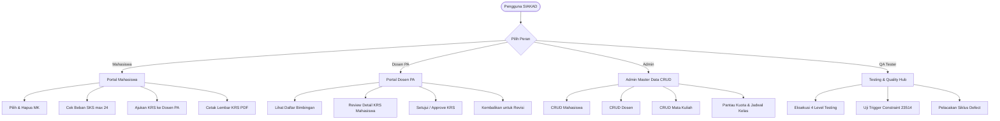
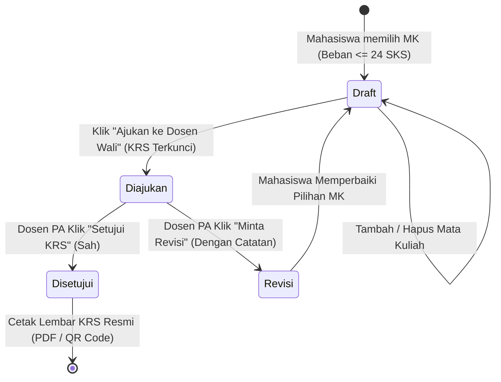

# SiakadKRS — Sistem Informasi Akademik (Modul KRS & Perwalian)
**Universitas Jenderal Achmad Yani (UNJANI)**  
Mata Kuliah: **SI611029 — Implementasi dan Pengujian Sistem Informasi**  
Dosen Pengampu: **Dr. Ir. Sigit Anggoro, S.T., M.T., IPM** & **Irma Santikarama, S.Kom., M.T**  

Repository: [https://github.com/Naysilla27/SiakadKRS](https://github.com/Naysilla27/SiakadKRS)

---

## 📌 1. Deskripsi Sistem
**SiakadKRS** adalah aplikasi *full-stack* berbasis web yang mengotomatisasi seluruh siklus pengisian Kartu Rencana Studi (KRS) dan proses bimbingan perwalian akademik di lingkungan Universitas Jenderal Achmad Yani (UNJANI). Sistem dirancang dengan standar arsitektur berlapis (*layered architecture*), integritas data relasional yang ketat, modul pengujian kualitas 4 level (*Unit, Integration, System, UAT*), serta dokumen cetak KRS resmi berstandar universitas.

---

## 💻 2. Teknologi & Bahasa Pemrograman yang Digunakan

Aplikasi ini dibangun menggunakan arsitektur modern berbasis **Client-Server RESTful API** dengan rincian bahasa dan teknologi sebagai berikut:

### A. Bahasa Pemrograman
| Komponen | Bahasa Pemrograman | Keterangan & Penggunaan |
| :--- | :--- | :--- |
| **Frontend** | **JavaScript (ES6+) & JSX** | Logika antarmuka reaktif, manajemen state React, manipulasi DOM, pemanggilan REST API secara asinkron (*Fetch/Promises*). |
| **Styling & UI** | **HTML5 & CSS3 (Tailwind CSS)** | Markup semantik modern, utility-first styling, desain responsif (Mobile, Tablet, Desktop), Dark/Light theme, dan aturan `@media print`. |
| **Backend** | **JavaScript (Node.js runtime)** | Server REST API, routing HTTP, validasi logika bisnis server-side, kontrol akses middleware, dan penanganan koneksi pool database. |
| **Database** | **SQL & PL/pgSQL (PostgreSQL)** | *Data Definition Language* (DDL), *Data Manipulation Language* (DML), *Foreign Key Cascades*, *Check Constraints*, dan *Stored Procedure / Trigger Function* (`fn_cek_maks_sks()`). |
| **Pengujian CLI** | **Python (v3.10+)** | Skrip otomasi pengujian constraint database (`test_constraints.py`) dan demonstrasi operasi CRUD CLI (`demo_crud.py`). |
| **Protokol Data** | **JSON (JavaScript Object Notation)** | Format standar pertukaran data (*payload request & response*) antara frontend dan backend. |

### B. Framework, Library, & Tools
* **Frontend**: React 18, Vite (Fast Bundler & HMR), Tailwind CSS, Lucide React (Icon System).
* **Backend**: Express.js, `pg` (node-postgres connection pool), `cors`, `dotenv`.
* **Database & Storage**: PostgreSQL 14+, pgAdmin 4, DBeaver, serta **Smart Persistent JSON Fallback Store** (`server/data_store.json`).
* **Version Control**: Git & GitHub.

---

## 👥 3. Penjelasan Hak Akses Role Pengguna (*User Roles & Permissions*)

Sistem memiliki **4 Peran Utama** dengan hak akses yang terisolasi dan spesifik sesuai proses bisnis akademik:



### 1. 🎓 Role Mahasiswa (*Student*)
* **Fungsi Utama**: Merencanakan beban studi semester aktif dan memantau status persetujuan KRS.
* **Hak Akses & Fitur**:
  - **Melihat Profil Akademik**: NIM, Nama, Program Studi, Dosen PA, Indeks Prestasi Semester Lalu (IPS), dan batas maksimal SKS yang berhak diambil.
  - **Memilih Mata Kuliah (Katalog Kelas)**: Menelusuri kelas yang tersedia berdasarkan semester (Semester 1 s.d. 5) dan menambahkan kelas ke daftar KRS.
  - **Validasi Beban SKS Real-time**: Indikator meteran beban SKS (*SKS Gauge*). Sistem otomatis memblokir pengambilan jika akumulasi SKS melebihi 24 SKS.
  - **Melihat Matriks Jadwal Mingguan**: Tampilan visual jadwal kuliah hari Senin s.d. Jumat untuk memastikan tidak ada jam mata kuliah yang bentrok.
  - **Mengajukan KRS (`draft` ➔ `diajukan`)**: Mengunci sementara draf KRS untuk diserahkan ke Dosen Pembimbing Akademik guna direview.
  - **Mencetak Lembar KRS Resmi**: Setelah disetujui Dosen PA, mahasiswa dapat membuka pratinjau dan mencetak lembar KRS resmi berstandar UNJANI (lengkap dengan kop universitas, data mahasiswa, tanda tangan, dan verifikasi QR Code).

### 2. 👨‍🏫 Role Dosen Pembimbing Akademik (*Dosen PA / Advisor*)
* **Fungsi Utama**: Melakukan bimbingan perwalian, evaluasi rencana studi, serta validasi kelayakan beban kuliah mahasiswa bimbingan.
* **Hak Akses & Fitur**:
  - **Dashboard Perwalian**: Memantau seluruh daftar mahasiswa bimbingan asuhan dosen yang bersangkutan beserta status KRS masing-masing (*Belum Isi, Draft, Diajukan, Disetujui, Perlu Revisi*).
  - **Review Rencana Studi (Modal Detail)**: Membuka rincian mata kuliah yang diambil mahasiswa (kode MK, nama MK, SKS, hari, jam, ruang).
  - **Aksi Persetujuan (*Approve KRS*)**: Mengesahkan KRS mahasiswa yang berstatus `diajukan` menjadi `disetujui`, disertai input catatan perwalian resmi.
  - **Aksi Pengembalian Revisi (*Revise KRS*)**: Mengembalikan KRS berstatus `diajukan` menjadi `revisi` dengan menyertakan instruksi catatan perbaikan yang wajib dibaca oleh mahasiswa.

### 3. ⚙️ Role Admin Akademik (*Administrator / Tata Usaha*)
* **Fungsi Utama**: Pengelolaan data master kampus secara penuh (*Full CRUD: Create, Read, Update, Delete*) dengan respon instan tanpa perlu me-refresh halaman.
* **Hak Akses & Fitur**:
  - **Master Mahasiswa**: Tambah mahasiswa baru, edit profil/angkatan/status/no HP, ganti dosen PA bimbingan, dan hapus data mahasiswa (dengan *cascade cleanup* ke KRS).
  - **Master Dosen**: Tambah data dosen, edit NIDN, nama lengkap dengan gelar, email, dan program studi.
  - **Master Mata Kuliah**: Tambah mata kuliah kurikulum, konfigurasi bobot SKS (1-6), penentuan penempatan semester (Semester 1-8). Sistem otomatis membuat kelas perkuliahan (*Auto-generate class*) agar langsung dapat dipilih mahasiswa.
  - **Monitoring Jadwal & Kuota Kelas**: Memantau kapasitas kuota ruang kelas, jumlah mahasiswa terisi (*enrolled*), ruang kelas, serta jadwal hari dan jam kuliah.

### 4. 🧪 Role QA & Software Tester (*Quality Assurance — SI611029*)
* **Fungsi Utama**: Pusat pengujian kualitas perangkat lunak terpadu sesuai capaian pembelajaran mata kuliah Implementasi dan Pengujian Sistem Informasi.
* **Hak Akses & Fitur**:
  - **Eksekusi 4 Level Testing Interaktif**:
    - **L1 Unit Testing**: Pengujian fungsi modular logika batas SKS berdasarkan IPS (`calculateMaxSks()`).
    - **L2 Integration Testing**: Pengujian interaksi endpoint API Express dengan PostgreSQL / Data Store.
    - **L3 System Testing**: Pengujian end-to-end integritas database trigger penolakan > 24 SKS (`Error Code 23514`).
    - **L4 User Acceptance Testing (UAT)**: Validasi skenario alur pengguna dari pengisian mahasiswa, review dosen, hingga persetujuan.
  - **Pelacakan Defect (*Defect Lifecycle Tracker*)**: Menganalisis siklus insiden kualitas: `Human Error` ➔ `Fault (Bug)` ➔ `Defect` ➔ `Failure` dengan status pelacakan (*Open, In Progress, Verified Fixed, Closed*).

---

## 🔌 4. Dokumentasi Spesifikasi REST API

Backend Express.js menyediakan RESTful API berbasis JSON yang melayani seluruh operasi sistem pada port **`5005`**:

| Modul | Method | Endpoint URL | Deskripsi Fungsi | Status Code |
| :--- | :---: | :--- | :--- | :---: |
| **System** | `GET` | `/api/health` | Status kesehatan server & metrik database | `200` |
| **Mahasiswa** | `GET` | `/api/mahasiswa` | Mengambil seluruh data mahasiswa + status KRS | `200` |
| | `GET` | `/api/mahasiswa/:nim` | Mengambil detail profil satu mahasiswa | `200`, `404` |
| | `POST` | `/api/mahasiswa` | Menambahkan data mahasiswa baru | `201`, `400` |
| | `PUT` | `/api/mahasiswa/:nim` | Memperbarui data profil mahasiswa | `200`, `404` |
| | `DELETE`| `/api/mahasiswa/:nim` | Menghapus mahasiswa & relasi KRS terkait | `200`, `404` |
| **Dosen** | `GET` | `/api/dosen` | Mengambil seluruh data dosen pengampu / PA | `200` |
| | `POST` | `/api/dosen` | Menambahkan dosen baru | `201`, `400` |
| | `PUT` | `/api/dosen/:id` | Memperbarui data dosen | `200`, `404` |
| | `DELETE`| `/api/dosen/:id` | Menghapus data dosen | `200`, `404` |
| **Mata Kuliah** | `GET` | `/api/matakuliah` | Mengambil daftar kurikulum mata kuliah | `200` |
| | `POST` | `/api/matakuliah` | Tambah mata kuliah baru (+ auto-generate kelas) | `201`, `400` |
| | `PUT` | `/api/matakuliah/:kode_mk` | Memperbarui nama/SKS/semester mata kuliah | `200`, `404` |
| | `DELETE`| `/api/matakuliah/:kode_mk` | Menghapus mata kuliah & jadwal kelasnya | `200`, `404` |
| **Kelas** | `GET` | `/api/kelas` | Mengambil jadwal kelas, kuota, & mahasiswa terisi | `200` |
| **KRS Transaksi** | `GET` | `/api/krs/:nim` | Mengambil rincian KRS, total SKS, & status | `200` |
| | `POST` | `/api/krs/add` | Mengambil mata kuliah ke KRS (Validasi max 24 SKS) | `200`, `400` |
| | `POST` | `/api/krs/remove` | Menghapus mata kuliah dari draf KRS | `200`, `400` |
| | `POST` | `/api/krs/submit` | Mengajukan draf KRS ke Dosen PA | `200`, `400` |
| | `POST` | `/api/krs/reset` | Mengembalikan status KRS ke draf (Alat Uji) | `200` |
| **Perwalian** | `GET` | `/api/perwalian/:id_dosen` | Daftar mahasiswa bimbingan per Dosen PA | `200` |
| | `POST` | `/api/perwalian/approve` | Menyetujui rencana studi KRS mahasiswa | `200`, `400` |
| | `POST` | `/api/perwalian/revise` | Mengembalikan KRS dengan catatan revisi | `200`, `400` |
| **Pengujian** | `GET` | `/api/test/constraints` | Uji otomatis constraint integritas database | `200` |
| | `GET` | `/api/test/defects` | Mengambil log daftar defect testing | `200` |

### Contoh Respon API Saat Pelanggaran Batas SKS (> 24 SKS):
Ketika mahasiswa mencoba mengambil mata kuliah yang menyebabkan total SKS melebihi 24 SKS, server memblokir dengan status **HTTP 400 Bad Request**:
```json
{
  "error": "Total SKS 25 melebihi batas 24 SKS",
  "code": "23514",
  "detail": "Ditolak: Mahasiswa tidak boleh melebihi batas 24 SKS per semester (Slide 15)."
}
```

---

## 📐 5. Aturan Bisnis & Siklus Status KRS (*KRS Lifecycle*)

Proses persetujuan KRS berjalan secara berurutan mengikuti diagram *State Machine* berikut:



1. **`draft`**: Mahasiswa bebas memilih dan membatalkan mata kuliah selama total SKS $\le 24$.
2. **`diajukan`**: KRS terkunci dari pengeditan mahasiswa dan masuk ke antrean verifikasi Dosen Pembimbing Akademik.
3. **`revisi`**: Dosen PA memberikan catatan kekurangan. Kunci terbuka kembali agar mahasiswa dapat memperbaiki rencana studinya.
4. **`disetujui`**: KRS disahkan secara sah oleh Dosen PA. Tombol **"Cetak Lembar KRS"** aktif.

---

## 📂 6. Struktur Direktori Proyek

```
ipsi_krs/
├── app/
│   └── demo_crud.py              # Skrip demonstrasi CRUD CLI Python
├── db/
│   ├── migrations/               # Skrip migrasi DDL bertahap
│   │   ├── 001_create_prodi_dosen.sql
│   │   ├── 002_create_mahasiswa_matakuliah.sql
│   │   ├── 003_create_kelas_krs.sql
│   │   ├── 004_add_aturan_maks_sks.sql
│   │   ├── 005_alter_mahasiswa_add_no_hp.sql
│   │   └── 006_add_indexes.sql
│   ├── seeds/
│   │   └── 001_referensi.sql     # Data awal referensi akademik
│   └── test_constraints.py      # Skrip pengujian 16 constraint database
├── server/                       # Backend REST API Express
│   ├── db.js                     # Konfigurasi pool koneksi PostgreSQL
│   ├── store.js                  # Persistent JSON storage driver
│   ├── data_store.json           # File penyimpanan data sinkron lokal
│   └── index.js                  # Routing REST API, validasi, & trigger logic
├── src/                          # Frontend React SPA
│   ├── components/
│   │   ├── Navbar.jsx            # Header, identitas UNJANI, & Role Switcher
│   │   ├── Notification.jsx      # Alert toast notifikasi interaktif
│   │   └── PrintKRSModal.jsx     # Template cetak KRS resmi berkop UNJANI
│   ├── pages/
│   │   ├── MahasiswaPage.jsx     # Portal Mahasiswa & jadwal mingguan
│   │   ├── DosenPage.jsx         # Portal Dosen Pembimbing Akademik
│   │   ├── AdminPage.jsx         # Portal Admin CRUD Master Data
│   │   └── QualityHubPage.jsx    # Portal QA Testing & Defect Tracker
│   ├── App.jsx                   # State manager utama aplikasi
│   ├── index.css                 # Konfigurasi Tailwind & print CSS
│   └── main.jsx                  # Entry point React Vite
├── init_krs_database.sql         # Master script SQL (Tabel, Trigger, & Seed)
├── run_web.bat                   # Launcher aplikasi 1-klik di Windows
├── app.bat                       # Runner CLI demo CRUD
├── dbtest.bat                    # Runner CLI pengujian constraint
├── package.json                  # Manajemen dependensi NPM
└── README.md                     # Dokumentasi utama proyek
```

---

## 🚀 7. Panduan Menjalankan Sistem di Komputer Lokal

### Prasyarat:
* **Node.js**: v18.0.0 atau lebih baru (Disarankan v20+ atau v24).
* **Git**: Terinstal pada sistem.
* *(Opsional)* **PostgreSQL** + **pgAdmin 4** atau **DBeaver** (Sistem tetap dapat berjalan penuh dengan *Local Storage Mode* jika PostgreSQL belum diinstal).

### Langkah Menjalankan:
1. **Clone repository ini**:
   ```bash
   git clone https://github.com/Naysilla27/SiakadKRS.git
   cd SiakadKRS
   ```
2. **Install seluruh dependensi**:
   ```bash
   npm install
   ```
3. **Konfigurasi Environment (`.env`)**:
   Salin file `.env.example` menjadi `.env`:
   ```bash
   cp .env.example .env
   ```
   *(Sesuaikan `DB_PASSWORD` dengan password PostgreSQL laptop Anda jika menggunakan PostgreSQL)*.

4. **Jalankan Aplikasi**:
   Buka dua terminal di VS Code:
   * **Terminal 1 (Backend API Port 5005)**:
     ```bash
     node server/index.js
     ```
   * **Terminal 2 (Frontend React Port 5173)**:
     ```bash
     npm run dev
     ```
   *(Atau di Windows cukup klik dua kali file **`run_web.bat`**)*.

5. **Buka di Browser**:
   * **Frontend Web**: [http://localhost:5173](http://localhost:5173)
   * **Backend API Health**: [http://localhost:5005/api/health](http://localhost:5005/api/health)

---

## 🗄️ 8. Panduan Setup Database di pgAdmin 4 / DBeaver

Bagi rekan kelompok atau penguji yang ingin menghubungkan langsung ke PostgreSQL lokal:

1. Buka **DBeaver** atau **pgAdmin 4**.
2. Buat database baru dengan nama: **`krs_dev`**.
3. Buka file master SQL: **[`init_krs_database.sql`](init_krs_database.sql)**.
4. Buka SQL Query Tool yang terhubung ke database `krs_dev`, salin seluruh isi file `init_krs_database.sql`, lalu tekan **Execute / Run** (`F5` atau `Alt + X`).
5. Seluruh 9 tabel, relasi foreign key, trigger `fn_cek_maks_sks()`, serta data awal 11 mata kuliah semester 5 (total 31 SKS) langsung terbentuk otomatis.

---

## 👥 9. Tim Pengembang & Identitas Akademik
* **Program Studi**: S1 Sistem Informasi — Fakultas Sains dan Informatika
* **Universitas**: Universitas Jenderal Achmad Yani (UNJANI), Cimahi
* **Mata Kuliah**: SI611029 Implementasi dan Pengujian Sistem Informasi
* **Tahun Akademik**: Semester Ganjil 2026/2027
