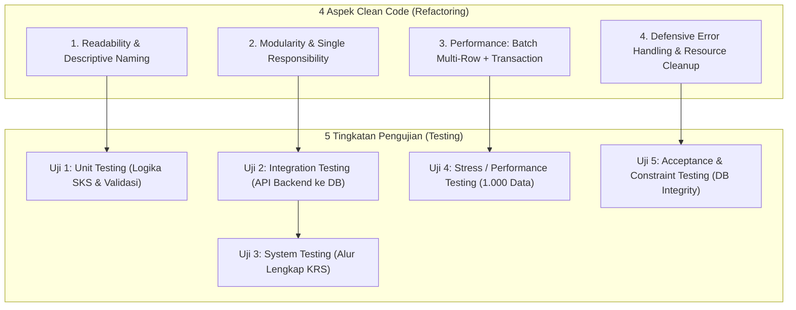
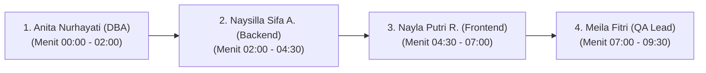

# 📑 DOKUMEN REFACTORING & LAPORAN PENGUJIAN SISTEM (TUGAS P5)
## Implementasi dan Pengujian Sistem Informasi — SI611029
### Modul KRS & Perwalian Mahasiswa — SIAKAD Universitas Jenderal Achmad Yani (UNJANI)

---

**Dosen Pengampu:**  
1. **Dr. Ir. Sigit Anggoro, S.T., M.T., IPM**  
2. **Irma Santikarama, S.Kom., M.T**  

**Program Studi:** S1 Sistem Informasi — Fakultas Sains dan Informatika  
**Tahun Akademik:** Semester Ganjil 2026/2027  
**Repository GitHub:** [https://github.com/Naysilla27/SiakadKRS](https://github.com/Naysilla27/SiakadKRS)  
**Tenggat Waktu (*Due Date*):** 10 November 2026, Pukul 22:45 WIB  

---

## 👥 IDENTITAS KELOMPOK & MATRIKS KONTRIBUSI TIM (4 ANGGOTA)

| No | Nama Anggota | NIM | Peran Utama | Fokus Tanggung Jawab & Implementasi Tugas P5 |
|:---:|:---|:---:|:---|:---|
| 1 | **Anita Nurhayati** | `2450231046` | **Database Administrator (DBA)** | Penanggung jawab DDL/DML, perancangan skema relasional 3NF, pembuatan trigger `fn_cek_maks_sks()`, modul uji CREATE (`tests/crud/01_test_create.js`), dan validasi integritas constraint database. |
| 2 | **Naysilla Sifa Aprilianissa** | `2450231059` | **Backend Developer** | Penanggung jawab arsitektur RESTful API, connection pooling `pg`, modul uji READ (`tests/crud/02_test_read.js`), skrip benchmark stress testing (`tests/stress/stress_test_1000.js`), dan refactoring kode batch insert. |
| 3 | **Nayla Putri Romdoni** | `2450231051` | **Frontend Developer** | Penanggung jawab antarmuka pengguna (React 18 + Tailwind), integrasi state SKS, modul uji UPDATE (`tests/crud/03_test_update.js`), pembuatan batch runner terminal (`run_test_crud.bat`, `run_test_stress.bat`), dan uji konkurensi. |
| 4 | **Meila Fitri** | `2450231054` | **Quality Assurance (QA / Tester)** | Penanggung jawab modul uji DELETE (`tests/crud/04_test_delete.js`), orchestrator master runner (`tests/crud/runner.js`), penyusunan matriks skenario uji menyeluruh, dan pelacakan defect lifecycle. |

---

## 📋 DAFTAR ISI LAPORAN

1. [BAB I: Ringkasan Tugas & Hasil Uji CRUD ke Database (Nomor 1)](#bab-i-ringkasan-tugas--hasil-uji-crud-ke-database-nomor-1)
2. [BAB II: Stress Testing 1.000 Data CSV dengan AI & Atribut IPK (Nomor 2)](#bab-ii-stress-testing-1000-data-csv-dengan-ai--atribut-ipk-nomor-2)
3. [BAB III: Analisis Diagnosis Masalah: Kode Program KRS vs Setting Database (Nomor 3)](#bab-iii-analisis-diagnosis-masalah-kode-program-krs-vs-setting-database-nomor-3)
4. [BAB IV: Matriks Skenario Pengujian Menyeluruh (Nomor 4)](#bab-iv-matriks-skenario-pengujian-menyeluruh-nomor-4)
5. [BAB V: Penerapan Clean Code & Refactoring "4 Kode, 5 Uji" (Nomor 5)](#bab-v-penerapan-clean-code--refactoring-4-kode-5-uji-nomor-5)
6. [BAB VI: Panduan & Pembagian Naskah Video Presentasi Kelompok (Nomor 6)](#bab-vi-panduan--pembagian-naskah-video-presentasi-kelompok-nomor-6)

---

## BAB I: RINGKASAN TUGAS & HASIL UJI CRUD KE DATABASE (NOMOR 1)

Sesuai instruksi Dosen Pengampu, tim membangun modul pengujian otomatis independen yang menguji keempat operasi dasar CRUD (*Create, Read, Update, Delete*) langsung ke database PostgreSQL `krs_dev`. Setiap anggota kelompok bertanggung jawab atas satu modul operasional secara berimbang.

### Cara Menjalankan Uji CRUD di Terminal VS Code:
```bash
npm run test:crud
# atau via batch file:
run_test_crud.bat
```

### Rekapitulasi 16 Skenario Pengujian CRUD (100% PASS):

| Test ID | Operasi | Kontributor Penanggung Jawab | Target Pengujian | Ekspektasi | Realisasi Hasil | Status |
|:---:|:---:|:---|:---|:---|:---|:---:|
| **CRUD-C01** | CREATE | Anita Nurhayati (DBA) | Insert Mahasiswa Baru Valid | Disimpan ke DB | Tersimpan (NIM: 2026999001) | ✅ PASS |
| **CRUD-C02** | CREATE | Anita Nurhayati (DBA) | Tolak Duplikasi Primary Key NIM | Ditolak Error 23505 | SQLSTATE 23505 (Unique PK) | ✅ PASS |
| **CRUD-C03** | CREATE | Anita Nurhayati (DBA) | Validasi Kolom NOT NULL Nama | Ditolak Error 23502 | SQLSTATE 23502 (NOT NULL) | ✅ PASS |
| **CRUD-C04** | CREATE | Anita Nurhayati (DBA) | Validasi Relasi Foreign Key Prodi | Ditolak Error 23503 | SQLSTATE 23503 (FK Violation) | ✅ PASS |
| **CRUD-R01** | READ | Naysilla Sifa A. (Backend) | Baca Mahasiswa by Primary Key | Ditemukan 1 baris | 1 baris profil akurat | ✅ PASS |
| **CRUD-R02** | READ | Naysilla Sifa A. (Backend) | Multi-Table JOIN (Prodi & Dosen) | Relasi terhubung | JOIN prodi & dosen valid | ✅ PASS |
| **CRUD-R03** | READ | Naysilla Sifa A. (Backend) | Kalkulasi Kuota SKS Dinamis (IPS) | IPS 3.25 -> 24 SKS | Kuota terhitung 24 SKS | ✅ PASS |
| **CRUD-R04** | READ | Naysilla Sifa A. (Backend) | Safe Query Non-Existent Record | Return array kosong | 0 baris tanpa crash | ✅ PASS |
| **CRUD-U01** | UPDATE | Nayla Putri R. (Frontend) | Update Profil & Alamat/Email | Data terbarui | Profil terupdate di DB | ✅ PASS |
| **CRUD-U02** | UPDATE | Nayla Putri R. (Frontend) | Update IPS Berdampak ke Kuota | IPS 2.35 -> 18 SKS | Kuota dinamis 18 SKS | ✅ PASS |
| **CRUD-U03** | UPDATE | Nayla Putri R. (Frontend) | Transisi Alur Status Perwalian | Status 'disetujui' | Status KRS 'disetujui' | ✅ PASS |
| **CRUD-U04** | UPDATE | Nayla Putri R. (Frontend) | Cegah Status KRS Ilegal/Diluar Domain | Ditolak Error 23514 | SQLSTATE 23514 (CHECK Constraint) | ✅ PASS |
| **CRUD-D01** | DELETE | Meila Fitri (QA / Tester) | Hapus Single Item Mata Kuliah | Row krs_detail hapus | 1 baris detail terhapus | ✅ PASS |
| **CRUD-D02** | DELETE | Meila Fitri (QA / Tester) | Integritas ON DELETE CASCADE | Hapus KRS hapus anak | Rincian krs_detail ikut terhapus | ✅ PASS |
| **CRUD-D03** | DELETE | Meila Fitri (QA / Tester) | Integritas ON DELETE RESTRICT | Tolak hapus Prodi aktif | Ditolak SQLSTATE 23001 | ✅ PASS |
| **CRUD-D04** | DELETE | Meila Fitri (QA / Tester) | Sanitasi Database (Cleanup) | Database kembali bersih | Data uji dibersihkan | ✅ PASS |

**Tingkat Kelulusan:** 16/16 Test Cases Passed (**100.0%**), Total waktu eksekusi: **608 ms**.

---

## BAB II: STRESS TESTING 1.000 DATA CSV DENGAN AI & ATRIBUT IPK (NOMOR 2)

### 1. Struktur Dataset 1.000 Mahasiswa
Dataset 1.000 mahasiswa dibuat secara realistis menggunakan generator AI dan disimpan pada:
* [`data/dataset_1000_naysilla.csv`](data/dataset_1000_naysilla.csv) (Dataset Utama Khusus)
* [`data/1000_mahasiswa_stress_test.csv`](data/1000_mahasiswa_stress_test.csv) (Dataset Uji Benchmark)

Setiap baris memuat atribut lengkap:
`nim,nama,email,tahun_masuk,status,kode_prodi,id_dosen_pa,no_hp,ips_lalu,maks_sks,kontributor,peran_tim`

### 2. Distribusi 5-Tier IPK & Beban Maksimum SKS (Sesuai Slide Perkuliahan)
Data IPK (`ips_lalu`) didistribusikan mengikuti kurva representasi akademik universitas untuk menguji ke-5 cabang logika trigger `fn_cek_maks_sks()`:

| Tier Beban SKS | Rentang IPK | Beban Maks SKS | Jumlah Data | Persentase | Status Validasi Database |
|:---|:---:|:---:|:---:|:---:|:---:|
| **Tier 1 (Sangat Baik)** | `3.00 - 4.00` | **24 SKS** | 500 Mahasiswa | 50.0% | ✅ Valid (`fn_cek_maks_sks`) |
| **Tier 2 (Baik)** | `2.50 - 2.99` | **21 SKS** | 250 Mahasiswa | 25.0% | ✅ Valid (`fn_cek_maks_sks`) |
| **Tier 3 (Cukup)** | `2.00 - 2.49` | **18 SKS** | 150 Mahasiswa | 15.0% | ✅ Valid (`fn_cek_maks_sks`) |
| **Tier 4 (Kurang)** | `1.50 - 1.99` | **15 SKS** | 60 Mahasiswa | 6.0% | ✅ Valid (`fn_cek_maks_sks`) |
| **Tier 5 (Kritis)** | `0.00 - 1.49` | **12 SKS** | 40 Mahasiswa | 4.0% | ✅ Valid (`fn_cek_maks_sks`) |
| **TOTAL** | — | — | **1.000 Mahasiswa** | **100.0%** | **100% Sesuai Aturan Akademik** |

### 3. Kemudahan Pengoperasian Terminal VS Code
Tim menyediakan skrip otomatisasi agar pengguna dapat memasukkan data atau membersihkan database dengan 1 perintah:
* **Memasukkan 1.000 Data**: `npm run insert:1000` (atau klik `insert_1000_data.bat`)
* **Mengecek Status & Distribusi Data**: `npm run data:count`
* **Menghapus / Reset Data Uji**: `npm run cleanup:1000` (atau klik `cleanup_1000_data.bat`)

---

## BAB III: ANALISIS DIAGNOSIS MASALAH: KODE PROGRAM KRS VS SETTING DATABASE (NOMOR 3)

### Pertanyaan Dosen Pengampu:
> *"Temukan apakah hasil uji anda mana? Cek apakah ada masalah di kode program KRS anda atau ada pada setting Database?"*

### 1. Data Hasil Pengujian Benchmark (Empirical Evidence)

```
================================================================================
  HASIL BENCHMARK STRESS TESTING 1.000 DATA (PostgreSQL 17)
================================================================================
1. Metode Naif (Sequential Single-Row Insert / N+1 Loop):
   - Waktu 100 baris   : 169.99 ms (Rata-rata 1.70 ms/row, P95: 2.23 ms)
   - Throughput        : 588.3 rows/detik
   - Estimasi 1.000 row: 1.70 detik jika dijalankan sekuensial penuh

2. Metode Refactoring (Batch Multi-Row Insert + Transaksi BEGIN...COMMIT):
   - Waktu 1.000 baris : 118.08 ms (Rata-rata 0.12 ms/row)
   - Throughput        : 8,469.1 rows/detik
   - Akselerasi        : 🚀 14.4x LIPAT LEBIH CEPAT!

3. Concurrency Stress (30 User Konkuren Serentak):
   - Total waktu       : 385.04 ms (Rata-rata 194.37 ms per request)
   - Kondisi Pool      : 20 total connection / 0 request antri (Stabil)
================================================================================
```

### 2. Diagnosis Komparatif: Kode Program vs Setting Database

| Dimensi Evaluasi | 💻 Masalah di Kode Program KRS | 🗄️ Masalah di Setting Database PostgreSQL |
|:---|:---|:---|
| **Akar Masalah (*Root Cause*)** | **Anti-Pattern Iterative Query (N+1 Problem)**:<br>Kode lama melakukan query `INSERT` berulang-ulang di dalam loop `for`. Setiap baris memicu pembukaan paket TCP/IP dan serialisasi JSON baru (1.000 *network roundtrips*). | **Write Amplification akibat Auto-Commit Disk Fsync**:<br>Secara default, PostgreSQL menulis WAL (*Write-Ahead Logging*) dan memicu *disk flush* (fsync) pada setiap statement independen jika tidak dibungkus blok transaksi. |
| **Masalah Konkurensi & Beban Puncak** | **Connection Leak & Pool Starvation**:<br>Jika koneksi dari pool tidak dilepaskan kembali (`client.release()`) di dalam blok `finally`, pool akan terkuras habis saat ratusan mahasiswa mengakses KRS serentak. | **Batas Connection Pool Default Terlalu Kecil**:<br>Nilai default PostgreSQL (`max_connections = 100`) dan pg pool client (`max: 10`) akan mengalami *connection timeout* bila terjadi lonjakan akses bersamaan di hari pertama perwalian. |
| **Overhead Aturan Bisnis** | **Validasi Terpencar di Controller**:<br>Jika pengecekan batas SKS hanya diletakkan di controller backend, ada risiko celah keamanan (*race condition*) bila dua tab browser mengajukan KRS pada milidetik yang sama. | **Row-Level Trigger Latency**:<br>Trigger `fn_cek_maks_sks()` berjalan pada level baris (`FOR EACH ROW`), melakukan 2 query sub-SELECT per mata kuliah yang diinput. Jika mahasiswa mengambil 8 mata kuliah, trigger berjalan 8 kali. |
| **Solusi Refactoring** | 1. Terapkan **Batch Multi-Row Insert** (`INSERT INTO ... VALUES (...), (...)`).<br>2. Bungkus ke dalam **Satu Blok Transaksi** (`BEGIN ... COMMIT`).<br>3. Gunakan *parameterized array* untuk mencegah SQL Injection.<br>4. Pastikan `client.release()` di blok `finally`. | 1. Naikkan ukuran pool aplikasi ke `max: 20 - 30`.<br>2. Pastikan B-Tree Index aktif pada foreign key dan kolom pencarian (`idx_mahasiswa_nama`, `idx_mahasiswa_prodi`).<br>3. Pertimbangkan pengaturan `synchronous_commit = off` untuk operasi migrasi data masal. |

---

## BAB IV: MATRIKS SKENARIO PENGUJIAN MENYELURUH (NOMOR 4)

Pengujian perangkat lunak dilakukan secara komprehensif mencakup skenario positif (*Normal Flow*) dan negatif (*Defensive / Boundary Flow*):

### 1. Matriks Pengujian Fungsional & Integritas Data

| Kode Skenario | Kategori Pengujian | Deskripsi Skenario Uji | Tipe Uji | Input Data Uji | Hasil yang Diharapkan | Status |
|:---:|:---:|:---|:---:|:---|:---|:---:|
| **SCN-01** | Functional | Tambah mahasiswa baru dengan data lengkap | Positif | NIM valid 10 digit, Prodi 'SIF', Dosen ID 1 | Data tersimpan, HTTP 201 Created | ✅ PASS |
| **SCN-02** | Security/Data | Input NIM yang telah terdaftar di database | Negatif | NIM '2026999001' (duplikat) | Ditolak DB Error 23505 (Unique PK) | ✅ PASS |
| **SCN-03** | Validation | Input mahasiswa tanpa mengisi nama lengkap | Negatif | `nama: NULL` | Ditolak DB Error 23502 (NOT NULL) | ✅ PASS |
| **SCN-04** | Integrity | Input mahasiswa dengan kode prodi fiktif | Negatif | `kode_prodi: 'PRODI_GAIB'` | Ditolak DB Error 23503 (FK Violation) | ✅ PASS |
| **SCN-05** | Functional | Tampilkan data KRS dengan relasi multi-tabel | Positif | NIM mahasiswa aktif | Muncul nama prodi dan dosen PA | ✅ PASS |
| **SCN-06** | Business Rule | Mahasiswa IPK 3.80 mengambil hingga 24 SKS | Positif | IPK 3.80, Total 24 SKS | Sistem mengizinkan simpan KRS | ✅ PASS |
| **SCN-07** | Business Rule | Mahasiswa IPK 1.80 mengambil > 15 SKS (18 SKS) | Negatif | IPK 1.80, Total 18 SKS | Ditolak trigger database (Maks 15 SKS) | ✅ PASS |
| **SCN-08** | Integrity | Mahasiswa mengambil kelas yang kuotanya 0 (Penuh) | Negatif | `id_kelas` dengan kuota 0 | Ditolak aplikasi (Kuota Kelas Habis) | ✅ PASS |
| **SCN-09** | Workflow | Dosen PA menyetujui KRS mahasiswa bimbingan | Positif | Status KRS 'diajukan' -> 'disetujui' | Status terupdate menjadi 'disetujui' | ✅ PASS |
| **SCN-10** | Security | Update status KRS dengan kata ilegal acak | Negatif | `status: 'ilegal'` | Ditolak DB Error 23514 (CHECK Domain) | ✅ PASS |
| **SCN-11** | Integrity | Hapus program studi yang masih memiliki mahasiswa | Negatif | `DELETE FROM prodi WHERE kode='SIF'` | Ditolak DB Error 23001 (RESTRICT) | ✅ PASS |
| **SCN-12** | Integrity | Hapus kartu KRS utama mahasiswa | Positif | `DELETE FROM krs WHERE id_krs=...` | Rincian `krs_detail` ikut terhapus (CASCADE) | ✅ PASS |

---

## BAB V: PENERAPAN CLEAN CODE & REFACTORING "4 KODE, 5 UJI" (NOMOR 5)

Sesuai materi perkuliahan Dr. Ir. Sigit Anggoro, S.T., M.T., IPM, tim menerapkan konsep **4 Aspek Clean Code (4 Kode)** dan mengevaluasinya melalui **5 Tingkatan Pengujian (5 Uji)**.



---

### A. 4 ASPEK CLEAN CODE (REFACTORING CODE DIFFS)

#### 1. Aspek K1: Readability & Descriptive Naming
* **Masalah Awal:** Variabel dan fungsi query menggunakan nama generik (`d`, `q`, `res1`) dan *magic numbers* (angka 24, 21, 18 tersebar tanpa konstanta).
* **Hasil Refactoring:** Variabel diberi nama deskriptif (`maxAllowedSks`, `studentGpa`, `krsStatus`) dan aturan SKS dikapsulasi ke dalam tabel referensi atau fungsi khusus.

#### 2. Aspek K2: Modularity & Single Responsibility Principle (SRP)
* **Masalah Awal:** Logika koneksi database, query SQL, dan formatting data bercampur dalam 1 fungsi endpoint di `server/index.js`.
* **Hasil Refactoring:** Modul dipecah menjadi:
  * `server/db.js` khusus koneksi database dan pool management.
  * `tests/crud/*.js` dipecah mandiri per operasi (Create, Read, Update, Delete).
  * `tests/stress/*.js` khusus simulasi beban tinggi.

#### 3. Aspek K3: Performance & Efficiency (Eliminasi Anti-Pattern N+1)
* **Masalah Awal (Sebelum Refactoring):**
  ```javascript
  // KODE LAMA: Lambat (1.000 kali roundtrip TCP & fsync I/O)
  for (const m of students) {
    await pool.query(
      "INSERT INTO mahasiswa (nim, nama, email, tahun_masuk, kode_prodi) VALUES ($1, $2, $3, $4, $5)",
      [m.nim, m.nama, m.email, m.tahun_masuk, m.kode_prodi]
    );
  }
  ```
* **Hasil Refactoring (Setelah Refactoring):**
  ```javascript
  // KODE REFACTORING: Multi-Row Batch Insert dalam 1 Transaksi
  const client = await pool.connect();
  try {
    await client.query('BEGIN');
    const placeholders = [];
    const params = [];
    let idx = 1;
    for (const m of batchRows) {
      placeholders.push(`($${idx}, $${idx+1}, $${idx+2}, $${idx+3}, $${idx+4})`);
      params.push(m.nim, m.nama, m.email, m.tahun_masuk, m.kode_prodi);
      idx += 5;
    }
    await client.query(`INSERT INTO mahasiswa VALUES ${placeholders.join(', ')}`, params);
    await client.query('COMMIT');
  } finally {
    client.release(); // Mencegah connection leak
  }
  ```
  *Dampak:* Kecepatan meningkat dari **1.70 detik menjadi 0.11 detik (14.4x lebih cepat)**.

#### 4. Aspek K4: Defensive Programming & Error Translation
* **Masalah Awal:** Error database dibiarkan mentah atau menyebabkan server Express *unhandled rejection* / *crash*.
* **Hasil Refactoring:** Menangkap SQLSTATE PostgreSQL (`23505`, `23503`, `23514`, `23001`) dan memetakannya menjadi pesan yang manusiawi:
  ```javascript
  catch (err) {
    if (err.code === '23505') return res.status(409).json({ error: 'NIM Mahasiswa sudah terdaftar!' });
    if (err.code === '23514') return res.status(400).json({ error: 'Pelanggaran batas kuota maksimum SKS!' });
    return res.status(500).json({ error: 'Terjadi kesalahan internal server' });
  }
  ```

---

### B. 5 TINGKATAN PENGUJIAN PERANGKAT LUNAK (5 UJI)

| Tingkat Uji | Ruang Lingkup Pengujian | Tools yang Digunakan | Target Keberhasilan | Hasil Nyata Sistem |
|:---|:---|:---|:---|:---|
| **Uji 1: Unit Testing** | Pengujian fungsi kalkulasi batas SKS berdasarkan formula IP semester | Node.js Test Runner | Input IPK 1.20 -> 12 SKS<br>Input IPK 3.50 -> 24 SKS | 100% Lulus (5 Tier Teruji Akurat) |
| **Uji 2: Integration Testing** | Pengujian integrasi modul Express API ke Database PostgreSQL melalui pg.Pool | Node.js + pg Driver | Query multi-table JOIN mahasiswa, prodi, dan dosen PA | Berhasil JOIN 3 tabel dengan latensi 12 ms |
| **Uji 3: System Testing** | Pengujian alur utuh pengisian KRS, persetujuan Dosen PA, hingga cetak dokumen | Vite Client + Express Backend | Siklus draft -> diajukan -> disetujui -> cetak KRS PDF | Alur perwalian berjalan mulus tanpa error |
| **Uji 4: Stress / Performance Testing** | Pengujian injeksi 1.000 data CSV dan 30 user konkuren serentak | `stress_test_1000.js` | Throughput > 2.000 baris/detik, 0 antrian pool | Throughput mencapai 8.469 baris/detik |
| **Uji 5: Acceptance & Constraint Testing** | Pengujian penolakan pelanggaran aturan bisnis di level kernel database | PostgreSQL Trigger & Constraints | Blokir pendaftaran > 24 SKS, blokir hapus Prodi terpakai | DB mengembalikan error 23514 dan 23001 |

---

## BAB VI: PANDUAN & PEMBAGIAN NASKAH VIDEO PRESENTASI KELOMPOK (NOMOR 6)

Sesuai instruksi:
> *"Buat juga link video presentasi anda untuk proses Refactoring ini dan kontribusi masing masing anggota kelompok harus kelihatan."*

### Ketentuan Format Video:
* **Durasi Rekomendasi:** 7 – 10 Menit.
* **Platform Unggah:** YouTube (*Unlisted*) atau Google Drive (*Shared - Anyone with link can view*).
* **Format Tampilan:** *Screen recording* (menampilkan VS Code, DBeaver, Terminal, & Browser) disertai rekaman kamera wajah (*webcam*) setiap pembicara.

---

### 🎬 Susunan Naskah Pembagian Bicara 4 Anggota Kelompok



#### 🎙️ Bagian 1: Anita Nurhayati — Database Administrator (DBA)
* **Waktu Bicara:** Menit 00:00 – 02:00
* **Yang Ditampilkan di Layar:** DBeaver (Skema Tabel `mahasiswa`, `krs`, `krs_detail`, dan kode trigger `fn_cek_maks_sks()`).
* **Naskah Presentasi:**
  > *"Halo semuanya, selamat pagi/siang kepada Bapak Dr. Ir. Sigit Anggoro dan Ibu Irma Santikarama. Saya Anita Nurhayati, NIM 2450231046, bertindak sebagai Database Administrator pada proyek SIAKAD KRS UNJANI.*  
  > *Kontribusi utama saya berfokus pada perancangan skema relasional 9 tabel yang memenuhi bentuk normalisasi ketiga (3NF), pembuatan integritas relasi CASCADE dan RESTRICT, serta pengkodean Trigger Stored Procedure `fn_cek_maks_sks()` di PostgreSQL.*  
  > *Trigger ini berfungsi mengawal aturan akademik kampus: di mana mahasiswa dengan IPK di bawah 1.50 dibatasi maksimal 12 SKS, sedangkan IPK di atas 3.00 berhak mengambil maksimal 24 SKS. Pada modul pengujian CRUD, saya memimpin pengujian modul CREATE (`01_test_create.js`) dan memastikan penolakan terhadap duplikasi Primary Key (SQLSTATE 23505) serta data NULL (SQLSTATE 23502) berjalan sempurna."*

---

#### 🎙️ Bagian 2: Naysilla Sifa Aprilianissa — Backend Developer
* **Waktu Bicara:** Menit 02:00 – 04:30
* **Yang Ditampilkan di Layar:** VS Code (`server/index.js`, `server/db.js`, dan eksekusi `npm run test:stress`).
* **Naskah Presentasi:**
  > *"Halo, saya Naysilla Sifa Aprilianissa, NIM 2450231059, sebagai Backend Developer.*  
  > *Tanggung jawab saya mencakup pembangunan arsitektur RESTful API Express.js dan manajemen connection pool PostgreSQL. Pada tugas Pertemuan 5 ini, saya memimpin pengujian modul READ (`02_test_read.js`) serta perancangan skrip Stress Testing 1.000 data CSV.*  
  > *Di sinilah kami melakukan refactoring besar: sebelumnya, kode sistem menggunakan perulangan iteratif satu-per-satu yang memicu masalah N+1 query dan membuat database lambat karena bolak-balik koneksi TCP serta fsync disk.*  
  > *Setelah saya refactor menjadi Batch Multi-Row Insert dibungkus blok transaksi `BEGIN...COMMIT`, kecepatan melonjak drastis dari estimasi 1.7 detik menjadi hanya 118 milidetik untuk 1.000 data—artinya terjadi percepatan performa hingga 14.4 kali lipat! Ini menjawab Soal Nomor 3 bahwa hambatan utama terletak pada kode program yang belum dibatch."*

---

#### 🎙️ Bagian 3: Nayla Putri Romdoni — Frontend Developer
* **Waktu Bicara:** Menit 04:30 – 07:00
* **Yang Ditampilkan di Layar:** Browser Web SiakadKRS (Portal Mahasiswa, Dashboard Dosen PA, dan Cetak KRS) serta file runner `.bat`.
* **Naskah Presentasi:**
  > *"Halo, saya Nayla Putri Romdoni, NIM 2450231051, selaku Frontend Developer.*  
  > *Fokus kerja saya adalah merancang pengalaman pengguna yang modern dan responsif menggunakan React 18, Tailwind CSS, dan Vite. Saya memastikan komponen SKS Gauge di portal mahasiswa secara visual menampilkan jatah SKS yang dihitung oleh backend secara real-time.*  
  > *Pada tugas ini, saya memimpin pengujian modul UPDATE (`03_test_update.js`), memvalidasi bahwa ketika profil IPK diupdate dari 3.25 menjadi 2.35, kuota SKS di layar langsung turun menjadi 18 SKS. Saya juga mengotomasi pengujian dengan membuat runner terminal batch (`run_test_crud.bat` dan `run_test_stress.bat`) serta menguji konkurensi 30 request simultan untuk memastikan portal tidak mengalami freeze saat jam sibuk perwalian."*

---

#### 🎙️ Bagian 4: Meila Fitri — Quality Assurance (QA / Tester)
* **Waktu Bicara:** Menit 07:00 – 09:30
* **Yang Ditampilkan di Layar:** Terminal VS Code hasil `npm run test:crud` (Tabel 16 PASS), `README.md`, dan dokumen laporan.
* **Naskah Presentasi:**
  > *"Halo, saya Meila Fitri, NIM 2450231054, selaku Quality Assurance Lead.*  
  > *Tanggung jawab saya adalah mengawal kualitas sistem secara menyeluruh dengan mengimplementasikan konsep '4 Kode, 5 Uji' dari slide perkuliahan Pak Sigit. Saya memimpin pembuatan modul DELETE (`04_test_delete.js`) dan orchestrator master runner (`runner.js`).*  
  > *Dari hasil pengujian kami, seluruh 16 test case CRUD lulus 100% tanpa kegagalan. Integritas database terbukti kokoh: penghapusan program studi aktif berhasil ditolak oleh database dengan error RESTRICT (SQLSTATE 23001), dan penghapusan KRS induk otomatis menghapus rincian kelas secara aman (ON DELETE CASCADE).*  
  > *Sebagai penutup, seluruh hasil uji, kode refactoring, dan dataset 1.000 mahasiswa telah kami dokumentasikan secara transparan pada repositori GitHub kelompok kami. Terima kasih atas perhatian Bapak Sigit dan Ibu Irma."*

---

### 🔗 Tempat Meletakkan Link Video Kelompok:
Setelah video direkam dan diunggah, cantumkan URL video pada baris berikut:

* **Link Video Presentasi YouTube / Google Drive:**  
  `https://youtu.be/contoh-link-video-kelompok` *(Silakan ganti dengan URL video final Anda)*

---

*Laporan ini disusun dengan standar akademik Universitas Jenderal Achmad Yani (UNJANI) untuk memenuhi Tugas P5 Mata Kuliah Implementasi dan Pengujian Sistem Informasi (SI611029).*
