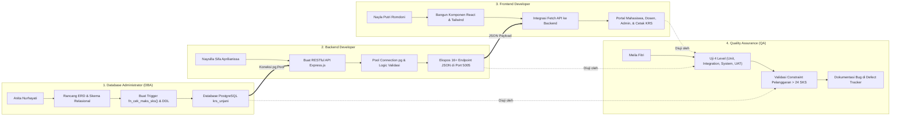

# 📋 Panduan Resmi Pembagian Peran & Tanggung Jawab Tim Pengembang
## Sistem Informasi Akademik (SiakadKRS — Modul KRS & Perwalian)
**Universitas Jenderal Achmad Yani (UNJANI)**  
**Mata Kuliah:** SI611029 — Implementasi dan Pengujian Sistem Informasi  
**Dosen Pengampu:** Dr. Ir. Sigit Anggoro, S.T., M.T., IPM & Irma Santikarama, S.Kom., M.T  
**Repository GitHub:** [https://github.com/Naysilla27/SiakadKRS](https://github.com/Naysilla27/SiakadKRS)

---

## 👥 Matriks Struktur Tim & Peran

| No | Nama Anggota | NIM | Peran Utama (*Role*) | Fokus Bidang Kerja | Bahasa & Teknologi Utama |
|:--:|:---|:---:|:---|:---|:---|
| 1 | **Naysilla Sifa Aprilianissa** | `2450231059` | **Backend Developer** | Server API, Business Logic, Routing & Database Pool | JavaScript, Node.js, Express.js, REST API |
| 2 | **Nayla Putri Romdoni** | `2450231051` | **Frontend Developer** | User Interface (UI), User Experience (UX), State & API Client | JavaScript (ES6+), React 18, Tailwind CSS, Vite |
| 3 | **Anita Nurhayati** | `2450231046` | **Database Administrator (DBA)** | ERD Schema, DDL/DML, Trigger Stored Procedure & Integrity | SQL, PL/pgSQL, PostgreSQL 17, DBeaver / pgAdmin 4 |
| 4 | **Meila Fitri** | `2450231054` | **Quality Assurance (QA / Tester)** | 4-Level Testing, Test Scenarios, Defect Lifecycle Tracking | Postman, Python Test Script, Manual/Automated Test |

---

## 🔄 Diagram Alur Kolaborasi Antar Peran (*Workflow Collaboration*)

---

## 1. ⚙️ Naysilla Sifa Aprilianissa — Backend Developer
* **NIM:** `2450231059`
* **Peran:** Backend Developer & API Architect
* **Bahasa Pemrograman:** **JavaScript (Node.js runtime)**
* **Teknologi & Library:** Express.js, `pg` (node-postgres connection pool), `cors`, `dotenv`, RESTful API architecture.

### A. Berkas Kode yang Dikelola (Ownership)
1. [`server/index.js`](file:///c:/Users/User/SiakadKRS/server/index.js): File sentral server yang memuat 16+ endpoint API, middleware error handling, penanganan CORS, dan validasi logika bisnis server-side.
2. [`server/db.js`](file:///c:/Users/User/SiakadKRS/server/db.js): Konfigurasi connection pool ke database PostgreSQL, deteksi lingkungan (lokal / cloud), penanganan SSL otomatis, dan mapping pesan error constraint PostgreSQL.
3. [`.env`](file:///c:/Users/User/SiakadKRS/.env) & `.env.example`: Manajemen variabel lingkungan rahasia (`DB_HOST`, `DB_PORT`, `DB_USER`, `DB_PASSWORD`, `DB_NAME`, `PORT`).

### B. Tanggung Jawab & Implementasi Nyata di Sistem
1. **Membangun REST API Berstandar Industri:** Merancang arsitektur API dengan metode HTTP yang tepat (`GET`, `POST`, `PUT`, `DELETE`) dan format respon JSON seragam.
2. **Koneksi Database Berkinerja Tinggi (*Connection Pooling*):** Menggunakan `pg.Pool` pada `server/db.js` agar aplikasi dapat menangani multiple concurrent request secara efisien tanpa membuka koneksi baru berulang kali.
3. **Logika Validasi Bisnis Server-Side:** Memastikan keamanan sistem dengan memeriksa batas maksimal 24 SKS, validasi kuota kelas sebelum pendaftaran, dan verifikasi status KRS (`draft` ➔ `diajukan` ➔ `disetujui`/`revisi`).
4. **Sanitisasi & Error Handling:** Menerjemahkan kode error PostgreSQL (seperti error trigger `23514`) menjadi pesan respon HTTP 400 Bad Request yang ramah dibaca frontend.

### C. Panduan Menjawab Pertanyaan Dosen / Penguji (*Cheat Sheet*)
> **Pertanyaan Dosen:** *"Naysilla, bagaimana backend Anda menghubungkan permintaan dari frontend ke database PostgreSQL?"*  
> **Jawaban:**  
> *"Backend kami dibangun dengan Node.js dan framework Express.js di file `server/index.js`. Setiap kali frontend mengirimkan request HTTP (misal `POST /api/krs/add`), Express menerima payload JSON, melakukan validasi awal, lalu menjalankan parameterized query ke PostgreSQL melalui modul connection pool `pg` di `server/db.js`. Pendekatan parameterized query ini menjamin keamanan dari serangan SQL Injection. Jika terjadi pelanggaran aturan—misalnya mahasiswa mengambil lebih dari 24 SKS—server langsung menangkap exception database dan mengembalikan respon HTTP 400 dengan pesan error yang spesifik."*

---

## 2. 🎨 Nayla Putri Romdoni — Frontend Developer
* **NIM:** `2450231051`
* **Peran:** Frontend Developer & UI/UX Designer
* **Bahasa Pemrograman:** **JavaScript (ES6+) & JSX, HTML5, CSS3**
* **Teknologi & Library:** React 18, Tailwind CSS (Utility-First CSS), Vite (Build tool & HMR), Lucide React (Icon System), Native Browser Print API (`@media print`).

### A. Berkas Kode yang Dikelola (Ownership)
1. [`src/App.jsx`](file:///c:/Users/User/SiakadKRS/src/App.jsx): Komponen induk penampung state global (peran pengguna aktif, status data, sinkronisasi notifikasi toast).
2. [`src/pages/MahasiswaPage.jsx`](file:///c:/Users/User/SiakadKRS/src/pages/MahasiswaPage.jsx): Halaman portal mahasiswa dengan katalog kelas per semester, kartu jadwal mingguan (*time schedule visualizer*), dan indikator meteran beban SKS (*SKS Gauge*).
3. [`src/pages/DosenPage.jsx`](file:///c:/Users/User/SiakadKRS/src/pages/DosenPage.jsx): Dashboard perwalian Dosen PA untuk mereview daftar bimbingan, menyetujui (*Approve*), atau meminta perbaikan (*Revise*) rencana studi.
4. [`src/pages/AdminPage.jsx`](file:///c:/Users/User/SiakadKRS/src/pages/AdminPage.jsx): Panel administrasi CRUD Master Mahasiswa, Master Dosen, Master Mata Kuliah, dan monitoring kuota kelas secara *real-time*.
5. [`src/components/PrintKRSModal.jsx`](file:///c:/Users/User/SiakadKRS/src/components/PrintKRSModal.jsx): Template dokumen cetak KRS resmi UNJANI lengkap dengan Kop Kampus, data mahasiswa, tanda tangan basah dosen/mahasiswa, dan QR Code verifikasi.
6. [`src/components/Navbar.jsx`](file:///c:/Users/User/SiakadKRS/src/components/Navbar.jsx): Navigasi atas dengan Role Switcher interaktif untuk berpindah 4 peran pengguna.

### B. Tanggung Jawab & Implementasi Nyata di Sistem
1. **Desain Antarmuka Modern & Responsif:** Menyusun tampilan menggunakan Tailwind CSS yang rapi, adaptif di layar laptop maupun mobile, dengan tata letak visual profesional bernuansa universitas.
2. **Manajemen State Reaktif (React Hooks):** Menggunakan `useState` dan `useEffect` untuk mengelola data katalog mata kuliah, daftar KRS mahasiswa, dan respon interaktif instan tanpa reload browser.
3. **Integrasi Asinkron REST API:** Mengirimkan pemanggilan `fetch()` ke endpoint Express di port 5005 dan menangani status loading, pesan sukses, hingga banner error secara visual.
4. **Fitur Cetak Dokumen Standar Akademik:** Merancang komponen `PrintKRSModal.jsx` dengan styling khusus `@media print` sehingga saat dicetak atau disimpan ke PDF, tampilan rapi satu halaman A4 tanpa elemen navigasi website yang mengganggu.

### C. Panduan Menjawab Pertanyaan Dosen / Penguji (*Cheat Sheet*)
> **Pertanyaan Dosen:** *"Nayla, bagaimana frontend memastikan mahasiswa tidak bingung saat memilih mata kuliah dan mengetahui jika SKS mereka sudah melebihi kuota?"*  
> **Jawaban:**  
> *"Di halaman `MahasiswaPage.jsx`, kami menyediakan indikator meteran SKS interaktif yang menghitung akumulasi secara langsung (real-time). Setiap tombol mata kuliah memiliki status visual: jika SKS sudah mencapai 24 SKS, tombol 'Ambil' otomatis dinonaktifkan atau memberikan notifikasi peringatan. Selain itu, kami menyediakan kartu jadwal mingguan hari Senin sampai Jumat agar mahasiswa langsung melihat visualisasi jam kuliah mereka dan menghindari bentrok jadwal."*

---

## 3. 🗄️ Anita Nurhayati — Database Administrator (DBA)
* **NIM:** `2450231046`
* **Peran:** Database Administrator (DBA) & Data Engineer
* **Bahasa Pemrograman:** **SQL & PL/pgSQL (Procedural Language / PostgreSQL)**
* **Teknologi & Tools:** PostgreSQL 17, DBeaver Community, pgAdmin 4, Database Normalization (3NF), Relational Constraints.

### A. Berkas Kode yang Dikelola (Ownership)
1. [`init_krs_database.sql`](file:///c:/Users/User/SiakadKRS/init_krs_database.sql): Master skrip DDL/DML lengkap yang memuat 9 tabel relasional, foreign keys, check constraints, trigger function, dan data seed awal.
2. [`db/migrations/`](file:///c:/Users/User/SiakadKRS/db/migrations/): Berkas migrasi database bertahap (`001_create_prodi_dosen.sql` hingga `006_add_indexes.sql`).
3. [`db/seeds/001_referensi.sql`](file:///c:/Users/User/SiakadKRS/db/seeds/001_referensi.sql): Data awal kurikulum, prodi, dan akun referensi akademik.

### B. Tanggung Jawab & Implementasi Nyata di Sistem
1. **Perancangan Skema Database Relasional (3NF):** Menyusun 9 tabel berelasi: `prodi`, `dosen`, `mahasiswa`, `matakuliah`, `periode`, `kelas`, `krs`, `krs_detail`, dan `aturan_akademik`.
2. **Integritas Referensial & Cascading:** Mengonfigurasi `FOREIGN KEY ... ON DELETE CASCADE` dan `ON DELETE RESTRICT` untuk mencegah data yatim (*orphan records*) saat mahasiswa atau mata kuliah dihapus.
3. **Stored Procedure & Trigger Pengaman Bisnis:** Mengembangkan fungsi PL/pgSQL `fn_cek_maks_sks()` dan trigger `trg_cek_maks_sks` pada tabel `krs_detail`. Trigger ini menghitung total SKS mahasiswa pada semester aktif secara atomik di level database; jika total SKS > 24, sistem melempar exception `RAISE EXCEPTION` dengan kode error `23514`.
4. **Maintenance & Administration:** Mengelola database `krs_unjani` pada PostgreSQL instance lokal (Port 5433), mengoptimalkan indeks pencarian NIM/Kode MK, dan memastikan skema sinkron antara database lokal dan lingkungan aplikasi.

### C. Panduan Menjawab Pertanyaan Dosen / Penguji (*Cheat Sheet*)
> **Pertanyaan Dosen:** *"Anita, mengapa aturan maksimal 24 SKS ditaruh di level Database Trigger, bukan hanya di Frontend atau Backend?"*  
> **Jawaban:**  
> *"Sebagai DBA, saya menerapkan prinsip pertahanan berlapis (defense-in-depth). Jika validasi hanya ditaruh di frontend, data bisa dibobol melalui manipulasi HTTP request atau direct API call. Dengan trigger PL/pgSQL `fn_cek_maks_sks()` pada tabel `krs_detail`, integritas database tetap terlindungi 100% meskipun ada request nakal yang masuk dari luar. PostgreSQL akan langsung menggagalkan transaksi (ROLLBACK) dan mengembalikan SQLSTATE 23514 (check constraint violation)."*

---

## 4. 🧪 Meila Fitri — Quality Assurance (QA / Tester)
* **NIM:** `2450231054`
* **Peran:** Quality Assurance Engineer & Software Tester
* **Bahasa & Alat Pengujian:** **Python (test automation), Postman (API testing), Jest/Manual Testing Matrix, Defect Tracker Hub**
* **Fokus Mata Kuliah:** Implementasi 4 Level Pengujian Perangkat Lunak & Siklus Pelacakan Defect (*Defect Lifecycle*).

### A. Berkas Kode yang Dikelola (Ownership)
1. [`src/pages/QualityHubPage.jsx`](file:///c:/Users/User/SiakadKRS/src/pages/QualityHubPage.jsx): Halaman dashboard pengujian interaktif di dalam aplikasi web yang menyajikan runner 4 Level Pengujian dan tabel pelacakan defect.
2. [`db/test_constraints.py`](file:///c:/Users/User/SiakadKRS/db/test_constraints.py): Skrip otomatisasi pengujian berbasis Python yang memvalidasi 16 constraint database secara programmatic.
3. [`app/demo_crud.py`](file:///c:/Users/User/SiakadKRS/app/demo_crud.py): Skrip skenario uji alur CRUD melalui antarmuka konsol/CLI.

### B. Tanggung Jawab & Implementasi Nyata di Sistem
1. **Perancangan 4 Level Pengujian Sistem Informasi:**
   * **Level 1 — Unit Testing:** Menguji fungsi modular internal, seperti algoritma kalkulasi kuota SKS berdasarkan IPS (`calculateMaxSks`).
   * **Level 2 — Integration Testing:** Menguji pertukaran data antara endpoint API Express.js dan database PostgreSQL (memastikan data yang disimpan di database terbaca persis oleh backend).
   * **Level 3 — System Testing:** Menguji sistem secara menyeluruh dari sisi aturan bisnis kritis, terutama pembuktian bahwa sistem sukses menolak upaya penambahan mata kuliah saat total SKS melebihi 24.
   * **Level 4 — User Acceptance Testing (UAT):** Menjalankan skenario alur nyata pengguna: Mahasiswa mengisi KRS ➔ Dosen PA mereview dan menyetujui ➔ Mahasiswa mencetak kartu KRS.
2. **Pengelolaan Siklus Hidup Defect (*Defect Lifecycle*):** Mendokumentasikan dan melacak anomali dari fase identifikasi `Human Error` ➔ `Fault (Bug)` ➔ `Defect` ➔ `Failure` dengan status `Open`, `In Progress`, `Verified Fixed`, hingga `Closed`.
3. **Pengujian Batas (*Boundary Value Analysis* & *Equivalence Partitioning*):** Memastikan batas kritis 23 SKS, 24 SKS (sukses), dan 25 SKS (gagal) terverifikasi dengan bukti log eksekusi.

### C. Panduan Menjawab Pertanyaan Dosen / Penguji (*Cheat Sheet*)
> **Pertanyaan Dosen:** *"Meila, bagaimana Anda membuktikan bahwa sistem ini sudah diuji dengan benar dan bebas dari celah pelanggaran SKS?"*  
> **Jawaban:**  
> *"Saya melakukan pengujian berlapis dengan metode 4 Level Testing yang dirangkum pada modul `QualityHubPage.jsx` dan skrip `db/test_constraints.py`. Pada Level 3 System Testing, saya melakukan Boundary Value Analysis dengan memasukkan mata kuliah hingga 24 SKS (berhasil), kemudian mencoba memasukkan mata kuliah tambahan sehingga total menjadi 26 SKS. Sistem secara konsisten menggagalkan transaksi dan mengembalikan kode 23514. Seluruh temuan pengujian dicatat secara transparan pada tabel Defect Tracker hingga statusnya 'Verified Fixed'."*

---

## 📊 Matriks Keterkaitan Antara Fitur, Modul, dan Peran

| Fitur Aplikasi | DBA (Anita) | Backend (Naysilla) | Frontend (Nayla) | QA (Meila) |
|:---|:---|:---|:---|:---|
| **Katalog & Pemilihan MK** | Tabel `kelas`, `matakuliah`, `periode` | `GET /api/kelas`, `POST /api/krs/add` | Halaman katalog kelas, SKS Meter | Skenario uji batas SKS (BVA) |
| **Batas Maksimal 24 SKS** | Trigger `fn_cek_maks_sks()` | Validasi 400 Bad Request di endpoint | Disable tombol & Toast alert | L3 System Testing (Code 23514) |
| **Alur Persetujuan Dosen** | Kolom `status` & `catatan_dosen` di `krs` | `POST /api/perwalian/approve` & `revise` | Portal Dosen PA, Modal Catatan | L4 User Acceptance Testing (UAT) |
| **CRUD Master Data** | Relasi DDL Foreign Key + Cascades | `POST/PUT/DELETE /api/mahasiswa` | Panel Admin CRUD responsif | L2 Integration Testing |
| **Dokumen Cetak KRS** | Data mahasiswa + relasi kelas terisi | Query join `krs_detail` + `matakuliah` | Template `PrintKRSModal` A4 print | Verifikasi kesesuaian layout fisik |
| **Quality & Defect Hub** | Tabel `defects` di PostgreSQL | `GET /api/test/constraints`, `/defects` | Dashboard testing interaktif | Manajemen siklus defect & runner |

---

## 💡 Panduan Presentasi Kelompok di Hadapan Dosen

Saat presentasi di depan dosen pengampu (**Dr. Ir. Sigit Anggoro** & **Irma Santikarama, S.Kom., M.T.**), jalankan urutan presentasi berikut:

1. **Pembuka & Gambaran Umum (Bisa diwakili Ketua / Semua):**
   * Menyapa dosen dan memperkenalkan nama anggota serta perannya masing-masing.
   * Menjelaskan tujuan aplikasi: Sistem SiakadKRS untuk mengotomatisasi pengisian rencana studi dan perwalian dengan integritas data yang kokoh.
2. **Sesi 1 — Anita Nurhayati (DBA):**
   * Buka DBeaver / pgAdmin 4.
   * Tunjukkan skema 9 tabel di database `krs_unjani`.
   * Tunjukkan kode trigger `fn_cek_maks_sks()` di `init_krs_database.sql` dan jelaskan bagaimana trigger tersebut menjamin integritas data di level basis data.
3. **Sesi 2 — Naysilla Sifa Aprilianissa (Backend):**
   * Buka terminal dan tunjukkan log server Express (`node server/index.js` di port 5005).
   * Tunjukkan endpoint `/api/health` di browser untuk membuktikan koneksi pool PostgreSQL aktif.
   * Tunjukkan file `server/index.js` pada fungsi penambahan KRS dan jelaskan error handling saat database menolak transaksi.
4. **Sesi 3 — Nayla Putri Romdoni (Frontend):**
   * Buka aplikasi web di browser (`localhost:5173`).
   * Demokan Portal Mahasiswa: ambil mata kuliah, tunjukkan meteran SKS yang naik secara real-time, lalu klik "Ajukan ke Dosen PA".
   * Beralih peran ke Dosen PA menggunakan Role Switcher: tunjukkan daftar bimbingan, beri catatan revisi atau persetujuan.
   * Kembali ke Mahasiswa dan demokan tombol "Cetak Lembar KRS Resmi" lengkap dengan layout cetak A4 dan QR Code.
5. **Sesi 4 — Meila Fitri (QA Tester):**
   * Buka menu "Quality & Testing Hub".
   * Jalankan 4 Level Testing langsung dari web: Unit Testing, Integration Testing, System Testing, dan UAT.
   * Tunjukkan bagaimana System Testing memicu error constraint 23514 secara sengaja untuk membuktikan kehandalan sistem.
   * Tunjukkan tabel Defect Lifecycle Tracker untuk membuktikan standar QA sesuai kurikulum mata kuliah SI611029.
6. **Penutup:**
   * Ringkas kesimpulan bahwa keempat pilar (DBA, Backend, Frontend, QA) telah terintegrasi secara modular, aman, dan siap digunakan.
