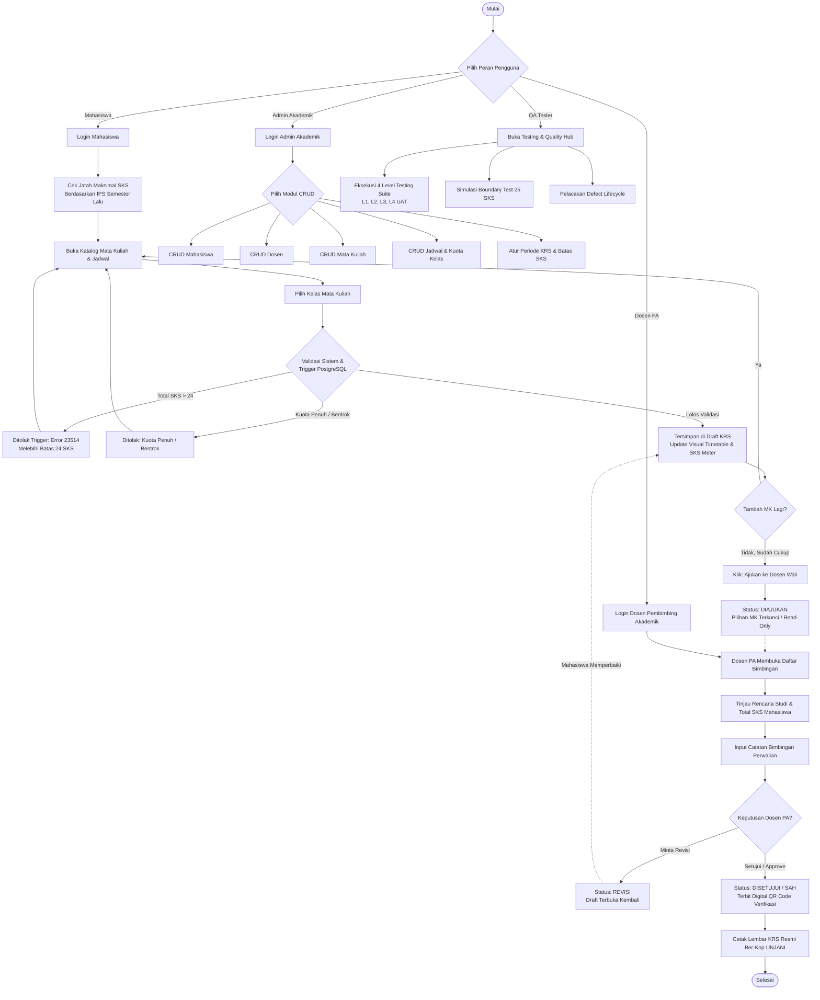
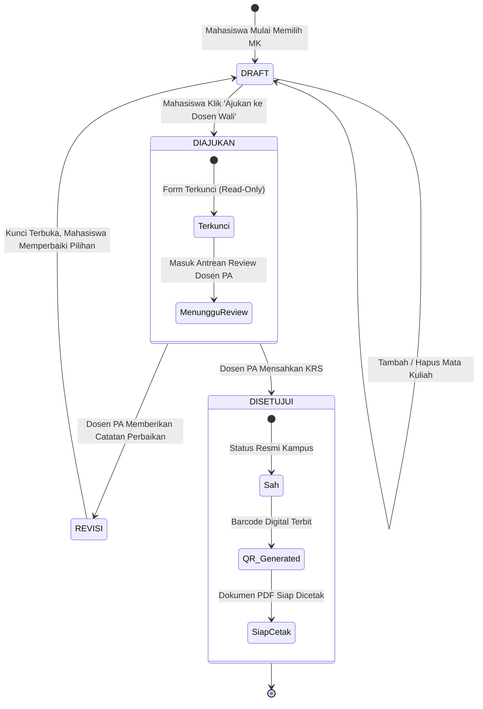
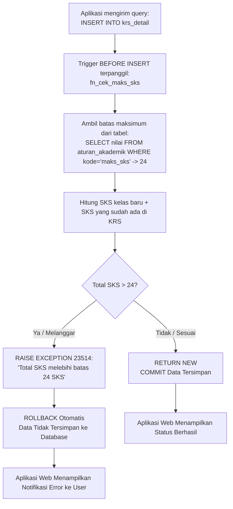

# ALUR DAN PROSES BISNIS SISTEM KRS & PERWALIAN
**SIAKAD — UNIVERSITAS JENDERAL ACHMAD YANI (UNJANI)**  
Mata Kuliah: **SI611029 — Implementasi dan Pengujian Sistem Informasi**

Dokumen ini menjelaskan seluruh diagram alir (*flowchart*), status siklus hidup (*lifecycle*), dan logika validasi yang bekerja di dalam sistem KRS.

---

## 1. DIAGRAM ALUR UTAMA (END-TO-END SYSTEM FLOW)

---

## 2. DIAGRAM SIKLUS STATUS KRS (KRS STATUS LIFECYCLE)

Setiap transaksi KRS mahasiswa mengalami 4 tahapan status:

---

## 3. LOGIKA VALIDASI TRIGGER DATABASE (SLIDE 14 & 15)

Proses penegakan aturan batas SKS dilakukan di tingkat **PostgreSQL Database Trigger** untuk menjamin data tidak dapat dimanipulasi melalui jalur mana pun:

---

## 4. PENJELASAN ALUR KERJA PER PERAN (ROLE RESPONSIBILITIES)

### A. Alur Mahasiswa
1. **Inisialisasi**: Mahasiswa membuka sistem, sistem membaca NIM, program studi, serta kuota maksimal SKS (standar 24 SKS).
2. **Eksplorasi**: Mahasiswa melihat katalog mata kuliah yang dibuka pada semester aktif (Semester Ganjil 2026/2027).
3. **Seleksi & Verifikasi Real-Time**:
   - Setiap kali memilih kelas, SKS Meter dan Kalender Visual Mingguan (Senin–Jumat) langsung diperbarui.
   - Jika kuota kelas penuh atau total SKS melampaui 24, sistem langsung memberi peringatan dan membatalkan penambahan.
4. **Pengajuan Bimbingan**: Mahasiswa mengklik tombol "Ajukan ke Dosen Wali". Status berubah menjadi `diajukan` dan formulir terkunci.
5. **Pencetakan**: Begitu Dosen PA menyetujui, tombol "Cetak Lembar KRS" aktif dan menghasilkan kartu studi resmi ber-Kop UNJANI dengan QR Code.

### B. Alur Dosen Pembimbing Akademik (Dosen PA)
1. **Monitoring**: Dosen PA melihat daftar seluruh mahasiswa perwalian yang diampunya beserta status KRS masing-masing.
2. **Review Rencana Studi**: Dosen membuka detail mahasiswa yang berstatus `diajukan` untuk memeriksa kesesuaian mata kuliah wajib, pilihan, dan prasyarat.
3. **Keputusan & Bimbingan**:
   - Jika disetujui: Dosen menekan tombol **Setujui & Sahkan KRS**, status berubah menjadi `disetujui`.
   - Jika tidak disetujui: Dosen menulis catatan perwalian (misal: *"Kurangi 1 MK pilihan agar tidak bentrok dengan KP"*) lalu menekan **Minta Revisi**. Status kembali ke `revisi` agar mahasiswa dapat memperbaiki.

### C. Alur Admin Akademik (CRUD Master Data)
1. **Master Mahasiswa**: Menambah mahasiswa baru, mengubah dosen pembimbing PA, atau menonaktifkan status mahasiswa.
2. **Master Dosen**: Mengelola identitas dosen, NIDN, email resmi, dan alokasi program studi.
3. **Master Kurikulum**: Mengatur mata kuliah, kode MK, bobot SKS (1–6), dan semester pelaksanaan.
4. **Master Kelas & Jadwal**: Menentukan kuota kelas, hari, jam pelaksanaan, dan ruang kuliah (misal: R.301, Lab Komputer).

### D. Alur Quality & Testing Hub (Materi SI611029)
1. **Automated Test Harness**: Mengevaluasi 4 tingkatan testing:
   - **L1 (Unit)**: Uji batas nilai 24 SKS vs 25 SKS.
   - **L2 (Integration)**: Uji integritas relasi foreign key dan composite key.
   - **L3 (System)**: Uji alur transaksi end-to-end.
   - **L4 (Acceptance/UAT)**: Uji kelayakan dokumen cetak resmi.
2. **Defect Tracking Lifecycle**: Melacak temuan cacat dengan tahapan:
   $$\text{Human Error} \longrightarrow \text{Fault (Code)} \longrightarrow \text{Eksekusi} \longrightarrow \text{Failure} \longrightarrow \text{Fix} \longrightarrow \text{Retest}$$
